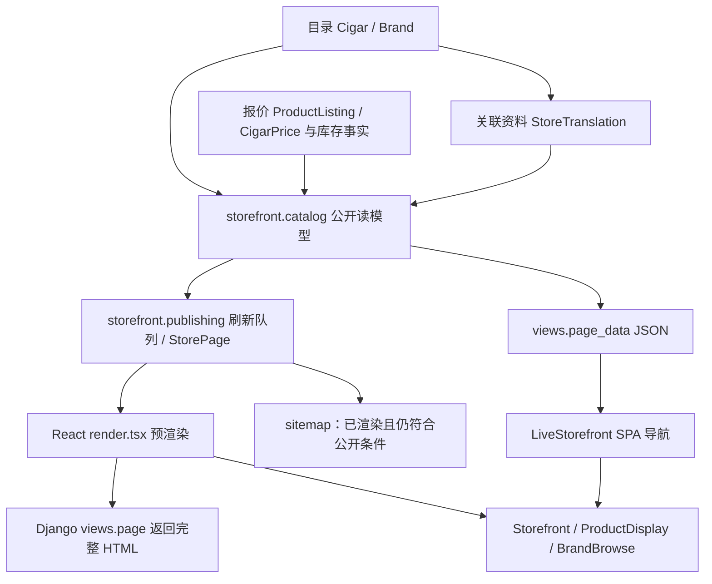

# Cohiba SEO 试点：架构、契约与验收

> 后续 SEO 方向、线上核查和任务状态统一维护在 [莫斯科门店 SEO 持续计划](seo-roadmap.md)。本文保留试点的实现与开发库验证历史，不代替当前生产状态。

> 2026-10-25 SEO-05：线上/本地差异、最新验证和发布顺序见 [发布准备清单](seo-05-release-preparation.md)。本地准备完成，生产尚未更新；勿用下方历史开发库告警推断生产情况。

日期：2026-10-25。状态：关联迁移、正式品牌导航及 SEO 修复已实现；按用户复审删除重复区块并修订三语文案，未部署。

范围：Cohiba 三语品牌页与 Genios、Mágicos、Siglo II、Siglo III 三语商品页。四款是内容验收范围，不是运行时特殊名单。本文取代此前固定四款入口和 Cohiba 索引豁免的草案。

## Zoom-out：公开商城在项目中的位置



- `cigardomtabaka_backend.urls.spa_index` 分流公开商城与内部工作台；内部资料库 `/library` 不是 SEO 商城。
- `catalog.build_pages` 管理稳定地址、内容、商品集合、分页及语言；`allowed_payload` 在请求与 sitemap 中阻止已撤回内容继续公开。
- `publishing` 管理持久渲染队列、版本及原子发布；不应在 React 中另造品牌 URL 或绕过发布层。
- `navigation.ts` 增强普通链接和 GET 表单；`metadata.ts` 同步客户端元信息，必须与首次 HTTP 一致。
- 库存历史决定销售货架，不能为了 SEO 创建采购批次或虚构现货。商品资料直接显示在商品详情页，无需新增独立指南页面或重复资料列表。

## 数据归属：审查结论

架构方向合理，保留现有预渲染与发布层。商品事实保存在 `Cigar`；三语资料沿用现有 `StoreTranslation`，增加显式 `cigar` 外键，作为 Cigar 的关联资料。不另建一套翻译模型，不给 Cigar 复制三语正文列或 JSON。

| 数据 | 唯一来源 |
| --- | --- |
| 商品身份、型号、产地、长度、环径 | `Cigar` |
| 商品三语标题、摘要、正文、别名 | 关联 Cigar 的 `StoreTranslation` |
| 品牌介绍、三语标题与摘要 | `kind=brand` 的 `StoreTranslation` |
| 包装、公开报价、库存、撤回状态 | 现有商品包装、报价、库存及 `ProductListing` |
| canonical、语言链接、索引资格 | 后端公开读模型统一生成 |
| 预渲染 HTML | `StorePage` 可重建缓存，不是内容源 |

原商品翻译只有字符串 `key`，数据库没有关联约束。现已增加外键，以 `cigar_id` 为身份，旧 key 作为兼容字段从它派生。约束要求商品类型必须关联 Cigar、非商品类型不得关联 Cigar、同商品同语言唯一。后台从商品维护资料，避免两个身份字段独立编辑。

当前 `Cigar.brand` 是字符串，本轮沿用正式品牌映射，不顺带迁移整个品牌领域模型。内容关联符合 [ADR 0023](adr/0023-storefront-prerender.md) 和 [SPA 导航合同](storefront-spa-contract.md)。

`storefront/cohiba_content.json` 仅作为已有导入清单和核对材料，不作为页面运行时来源。清单商品 ID 用于导入身份核实，不作为组件的固定名单。已有导入命令同时涉及盒价，本次关联迁移不重新触发价格写入。

## 本轮设计决定

1. 正式地址保留 `/brand/cohiba`、`/ru/brand/cohiba`、`/en/brand/cohiba`，商品地址保留数字 ID 和现有 slug。
2. 品牌 Logo、品牌名称及菜单统一进入本语言的正式品牌页。目录里的品牌复选框仍是多选筛选；品牌页内部筛选保留品牌路径。跨品牌导航清除旧筛选，不把一个品牌的条件隐式带入另一个品牌。
3. 旧 `/catalog?brand=cohiba` 仍可作为筛选地址使用，保持基础目录 canonical 和 noindex。本轮不强制 301：编辑品牌页与筛选页的内容职责不同，且不应破坏筛选面板行为。
4. 品牌页主体保留品牌介绍和现有商品列表。删除独立型号资料区和页内“按品牌浏览”，顶部品牌菜单保留。商品正文与摘要保存在关联 Cigar 的翻译记录，详情页直接读取；品牌页不再重复展示资料摘要。商品列表继续遵循现有库存规则。
5. 保留现有翻译完整性与索引规则，不为 Cohiba 或四款商品增加豁免。删除型号资料区时同步删除其后端加载与翻译依赖；拒绝包含旧 `model_articles` 字段的缓存，避免继续输出已移除区块。
6. 本轮不扩展全站品牌总览或批量清理历史 URL。独立检查 15 个目标页，不能用全站 `ready: true` 代替试点可收录验收。
7. 视觉沿用 B2。本次在既有 CigarDomTabaka 项目以 Claude Code 完成独立 OD 修订，产物为 `cohiba-brand-refined-20261025/index.html` 与同目录 `NOTES.md`。运行器约束已写入 `AGENTS.md`，禁止使用或自动回退到 Codex。React 已接入递增环径圆点、长度条、移动筛选图标、236px 侧栏和品牌介绍排版；共享筛选组件同步覆盖目录页。窄切片中的长度条改为文字上方排列，保持实际图示宽度，避免挤压文字。仅保留全站顶部品牌菜单，不复制预览中多余的品牌横条；不引入样例报价、库存、直方图及预览中的价格档位或重置行为。
8. 没有商品和品牌正文的空品牌页保持可浏览，但 noindex，不进入 sitemap/hreflang。首页第 2 页起为重复目录入口，统一 noindex；正式 `/catalog?page=N` 分页保留自 canonical 与正常索引规则。

`published` 表示允许公开，不代表正文足够丰富；现有规格模板也可能已经发布。本轮人工核对目标资料，不按正文长度、固定 ID 或隐藏特例判断内容质量。以后需要编辑精选时再增加明确的管理能力。

## SEO 内容契约与依据

| 页面内容 / 元信息 | 来源 | 验收要求 |
| --- | --- | --- |
| H1 / 展示名称 | 同语言翻译标题及现有型号事实 | 主标题清楚，同语言命名一致 |
| HTML title / OG title | `storefront.seo` 从公开页面数据生成 | 品牌、型号、页面用途和店名有区分；确有公开报价才使用“价格”字样 |
| meta description | 同语言 `StoreTranslation.description` | 每页独立概括内容，不只复制标题或堆砌别名 |
| 可见正文 | 同语言 `StoreTranslation.body` 与 Cigar 规格 | 初始 HTML 可读；品牌介绍历史与产品线，商品介绍本款系列、烟叶、工艺与规格，不机械比较型号 |
| 品牌到商品链接 | 现有商品列表 | 普通 `<a href>`，无 JS 可抓取，撤回后缓存不能继续公开 |
| canonical / hreflang | 公开读模型 | 各语言自 canonical；hreflang 只包含符合现有公开及索引条件的版本 |
| robots / sitemap | 公开资格与筛选规则 | HTTP、HTML、SPA 和 sitemap 一致；预览始终额外 noindex |

- URL：内部链接、canonical、sitemap 使用同一正式地址。查询参数本身不是 SEO 错误，需要区分品牌导航和筛选意图并控制重复地址。依据：[Google 电商 URL 指南](https://developers.google.com/search/docs/specialty/ecommerce/designing-a-url-structure-for-ecommerce-sites)。
- 标题：简洁、准确，与主内容语言一致，不以固定字符数作为质量门槛；搜索引擎可能重写标题。依据：[Google 标题指南](https://developers.google.com/search/docs/appearance/title-link)。
- 摘要：与页面有关且有区分。Google 也可能从可见正文生成摘要，不能只填 meta 而省略正文。依据：[Google 摘要指南](https://developers.google.com/search/docs/appearance/snippet)。

### 高希霸资料核对

- 品牌介绍以品牌历史和产品线为主体，三语均压缩为两段：第一段保留 1966 年创立、早期国宾礼品、1982 年国际市场与 El Laguito 工厂；第二段概括 Línea Clásica、Línea 1492、Maduro 5、Behike 的特点。删去名称来源及各系列发布年份，避免首屏文字挤压商品。品牌标题复用现有 `BRAND_LOGO_LOCAL` Logo。
- 商品正文与摘要围绕当前型号的系列定位、烟叶、制作工艺和品型组织；尺寸仅为必要规格，不机械插入其他型号的尺寸比较。中文标题去掉重复的英文全名，英文名称仍由 Cigar 与搜索别名承载。店名、所在地、包装区、报价、库存和联系指引不混入资料字段。
- Genios：Maduro 5，140 mm，52 环径；Mágicos：Maduro 5，115 mm，52 环径；Siglo II：Línea 1492，129 mm，42 环径；Siglo III：Línea 1492，155 mm，42 环径。既有事实来源见 [首批内容记录](cohiba-seo-rollout.md#内容来源与约束)。发现文案和 Cigar 冲突时先核实。
- 六款三语正文已删除机械的同系列尺寸比较。Maduro 5 说明深色茄衣的五年自然陈化及长芯手工工艺；Siglo II/III 说明 Línea 1492、品型、中等风格与制作特点；BHK 52/56 说明 Medio Tiempo、手工卷制和产区，不在单品正文罗列 52/54/56/58。无成品年龄或盒子生产年份的解释性句子，不编造香气品鉴。
- 本次资料核对（2026-10-25）：[Habanos 品牌历史与产品线](https://www.habanos.com/en/the-habanos-brands-academia/cohiba-brand/)、[Maduro 5 发布](https://www.habanos.com/en/news/habanos-s-a-presenta-maduro-5-la-nueva-linea-de-cohiba-en/)、[茄衣陈化工艺](https://www.habanos.com/en/ageing-habanos/)、[Behike 发布与用叶](https://www.habanos.com/es/news/nace-cohiba-behike-la-linea-mas-exclusiva-de-habanos-s-a-es/)、[Behike 长芯手工工艺与 Medio Tiempo](https://www.habanos.com/en/news/the-magic-of-behike-a-documentary-series-exploring-cohiba-behikes-success-story/)、[官方型号目录](https://www.habanos.com/en/vitolarios/)、[Cohiba 发酵工艺](https://www.habanos.com/en/news/habanos-s-a-presents-its-world-premiere-of-the-new-cohiba-brand-vitola-novedosos-in-spain/)。未把历史发布文章中的型号数量写成今天的完整系列名单。
- 实时金额、库存不写入静态正文或摘要。别名用于站内检索和自然消歧，不新增 meta keywords；不编造品鉴、授权或现货保证。

### 翻译与索引的实际限制

缺译 noindex 是本项目既有发布策略，不是 Google 对所有网站的统一要求。本轮保留该策略。中文历史页面目前存在默认可索引的兼容行为，因此仍需单独验收中文内容，不能以 `indexable=true` 证明内容质量。

本地俄英 Cohiba 品牌页原因可见 BHK 商品缺译而 noindex。现已核对并补充 BHK 52（119 mm / 52）与 BHK 56（166 mm / 56）的三语资料，来源为 [Habanos 官方 Behike 发布资料](https://www.habanos.com/en/news/nace-cohiba-behike-la-linea-mas-exclusiva-de-habanos-s-a-en/)，保存在 `cohiba_supporting_content.json`，显式发布到开发库。三语品牌页现均满足索引条件。生产商品集合不同，部署前必须重新核对可见商品及相关推荐的翻译依赖。

筛选参数包括 `q`、`brand`、`box`、`sort`、长度/环径/价格上下限及 `stock_only`。已补齐客户端 robots 判断，与服务端一致。

## 迁移与实现边界

独立设计审查支持沿用现有翻译表增加关联，实施必须处理以下风险：

1. 预检非数字 key、失效商品及 `01`/`1` 等规范化冲突。异常时停止并报告，不丢弃或合并用户正文。
2. 先增加可空关联、回填与校验，再增加约束。保留标题、摘要、正文、发布状态和更新时间；在本地验证回退路径。
3. 同步兼容 `publish_storefront_catalog`、`prepare_storefront_localizations`、`prepare_cohiba_content`；尤其覆盖 `full_clean()` 和 `save(update_fields=...)`，避免关联漏存。
4. 验证全量与请求级构建一致，以及删除、撤回、取消发布后旧 HTML 的失效行为。
5. 不修改价格、库存、会计或商品上架状态。内容导入默认保持翻译发布状态；只有显式 `--publish-supporting` 会发布核实后的 BHK 支持资料。生产迁移、数据写入和部署遵循仓库安全边界。

## 验收与观察

- 三语首页/目录的品牌 Logo 和顶部品牌菜单均为真实 `<a href>`，进入对应正式品牌页；品牌页不显示重复品牌浏览区。
- 15 个页面初始 HTML 有 H1、核实正文、规范 canonical；商品正文只在详情页显示。
- 目标页索引资格和 hreflang 一致；草稿、删除、撤回及缺译有回归测试。预览站始终额外 noindex。
- 迁移成功、冲突及回退路径，旧内容命令兼容，外键与 key 身份一致性，以及全量/请求构建一致性均需测试。
- 所有筛选参数在服务端和客户端一致 noindex，正式目录分页自 canonical，首页重复分页 noindex；未知 URL 返回真实 404。
- 发布前核对渲染产物、报价与盒规；内容、上架和实际库存分别验收。生产数据更改与部署需用户明确授权，准确 SHA 的 CI 通过后再发布。
- 正式发布当天记录 Google Search Console / Yandex Webmaster 中这 15 个 URL 的索引、搜索曝光、点击和查询词基线；7/14/28 天复查。用实际收录与目标查询趋势决定是否推广其他品牌，不承诺固定排名或时限。Metrica 继续暂缓。

## 实施状态

2026-10-25 两段简介与 SEO 复核：仅更新三条品牌正文，中文由 326 字符降为 172 字符；1440px 下正文高度由约 316px 降至 121px，360px 下由约 462px 降至 194px。英俄同步精简，六种语言/宽度组合均无横向溢出、浏览器错误。开发预渲染仅刷新三个品牌页，重复导入零变更。备份 `/tmp/cohiba-before-compact-intro.db`；截图和报告 `/tmp/cohiba-compact-verification/`。

本轮对 21 个目标 URL 实际 HTTP 复核：初始 HTML 含正文及单一 H1，自 canonical、三语 hreflang、sitemap 目标覆盖、首页到品牌普通链接通过；筛选请求由 HTTP `X-Robots-Tag` 标记 noindex，未知品牌返回 404。严格内容审计为 0 error、13 warning，与下述既有缺口一致。预览额外全站 noindex，读模型允许索引不代表预览可被收录。

2026-10-25 品牌历史、Logo 与六款商品文案修订：内容导入 13 项、前端商城交互 37 项目标测试通过，typecheck、ESLint、前端/SSR 构建通过。开发库更新 21 条三语资料并重新生成 4203 页；21 个目标页初始 HTML 与严格 SEO 检查无 error，重复导入零变更。三语品牌页在 1440/360px 验证 Logo 加载与无横向溢出，魔术师和 BHK 56 商品标题、正文通过浏览器验证，无 JavaScript 错误。报告与截图为 `/tmp/cohiba-editorial-verification/`。严格检查仍有 13 条既有 warning：门店照片缺失 3、历史商品缺少列表入口 9、门店资料待确认 1，未以编造资料或新增重复入口消除。对照 `/tmp/cohiba-before-editorial.db`，五张业务表及翻译发布状态未改变；仅更新开发库，未部署。

已完成代码架构和官方 SEO 文档核对、独立设计审查及最终独立代码审查。已修复审查中发现的软删除商品后台表单异常，以及精确语言空正文错误继承英文正文、导致 hreflang 失效判定不一致的问题。

- 本次修订后端 storefront 158 项测试通过；前端 storefront 121 项测试通过。
- OD 图标整合后，数值筛选与商城交互 45 项目标测试、typecheck、ESLint 和前端/SSR 构建通过；独立审查无 Critical / Important。
- Django check、迁移一致性检查通过；迁移覆盖成功、非法/冲突 key 与回退路径。
- 本次开发库 4203 页已重新预渲染。品牌与六款商品共 21 个三语页面的初始 HTML、正文、canonical、hreflang 和严格 SEO 检查通过；移除的区块与旧 `model_articles` 数据均不存在。报告与截图在 `/tmp/cohiba-copy-verification/`。
- 浏览器验证 1440、390、360px 无横向溢出，圆点/横条按 OD 尺寸递增；移动抽屉键盘选择、Escape 放弃草稿并还原焦点、重新打开、应用筛选和 noindex 同步通过。语言切换与从筛选目录进入无参数品牌页通过，JavaScript 错误为零。
- 仅操作 `cigars_dev.db`；备份为 `/tmp/cohiba-seo-before-20261025.db`。商品、价格、采购批次、库存流水、商品上架记录逐行对照验证；本轮不写生产、不 push、不部署。
- 内容命令再次预览零变更；上述五张业务表与修订前备份 `/tmp/cohiba-before-copy-revision.db` 逐行一致，翻译发布状态未改变。

开发内容更新命令（生产库会被拒绝）：

```bash
DJANGO_DEBUG=True .venv/bin/python manage.py prepare_cohiba_content --content-only --include-supporting --publish-supporting
# 上行只预览；核对后增加 --apply 写开发库。
```

单页/多页严格验收使用 `check_storefront_seo --strict --path /brand/cohiba --path /ru/brand/cohiba`，可继续重复 `--path`。目标缺失或不可收录会失败；门店信息等待核实项仍作为 warning，不能将退出码 0 解读为内容全部完善。

### 改版 SEO 效果判断（2026-10-25）

> 同日后续线上核查更正：四款试点的三语 sitemap 和品牌页链接已存在。下方“九个语言页面缺少列表入口”属于当时开发库结果，不再作为线上待办。线上仍有旧版品牌资料；详见 [持续计划的现状与证据](seo-roadmap.md#3-已知现状与证据)。

结论：品牌正式入口、主题清晰的品牌及商品内容、可抓取链接和重复 URL 控制改善了 SEO 基础；两段简介改善阅读与商品发现，不把字数或视觉变化当作排名指标。预渲染属于既有架构，本轮验证内容仍在初始 HTML 中，不宣称本轮新增了 SSR。

- 品牌页满足品牌介绍与商品浏览意图，产品线信息仍完整；商品页承接具体型号信息。精简没有删掉商品正文。Google 没有最低字数或固定段落数要求，依据：[SEO Starter Guide](https://developers.google.com/search/docs/fundamentals/seo-starter-guide)。
- 目前最重要的试点缺口是 Genios、Siglo II、Siglo III 缺少首页、目录或品牌商品列表内链，共九个语言页面。它们在 sitemap 中，但 sitemap 不能代替清晰的导航关系。后续应评估让已有资料商品在现有商品列表内自然可达，并正确表示无现货；不新增重复资料 section，不通过伪造库存解决。依据：[Google 电商站点结构](https://developers.google.com/search/docs/specialty/ecommerce/help-google-understand-your-ecommerce-site-structure)。本次仅记录建议，未改变货架规则。
- 仍需核实门店资料并补实拍。自动审计通过不能代替编辑判断、实测性能或生产验收；本轮未测 Core Web Vitals，也未读取搜索后台数据。
- 正式部署后再记录 Search Console / Yandex Webmaster 的索引、目标查询曝光、点击与落地页表现，于 7/14/28 天复查；实际搜索收益目前未验证。当地搜索与品牌/型号查询分别观察，不能将点击增长全部归因于这次改版。

### 其他全站余项

前一轮本地全站审计发现空品牌壳、规格模板正文、缺少入口的历史商品、翻译回退，以及门店实拍缺失和信息未确认。删除型号资料区后，仅有资料、未进入现有商品列表的详情页可能再次出现缺少内部入口的 warning；这是遵循用户页面结构要求后的现状，不另加一个重复入口规避告警。空壳和缺译页继续 noindex；历史正文和真实门店材料仍需逐批核实。

生产落地仍需明确授权、准确 commit 的 CI 及生产数据预检；开发库验收不能证明生产已经修复。搜索后台实际收录、曝光与排名观察在发布后进行。
